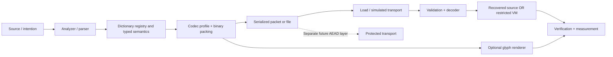

# BinBol — From Binary to Symbol
## Project Vision + Mechanics Lab Architecture | Design Draft v0.7

**Tagline:** Encode the meaning. Visualize the bits.  
**Status:** Architecture and UX proposal — **not** a replacement for existing formats or engines yet.  
**Reference branch:** `preview/binbol-landing-v04`  
**Design review date:** 2026-11-19

---

## 1. The original idea — preserve this before building anything else

BinBol is an experimental system that connects **meaning, binary representations and optional glyph-based visual language**. It investigates whether **well-defined operations, strings and repeated structures** can be represented by compact identifiers, transferred or stored using explicit encoding schemes, reconstructed by an endpoint that knows the definitions, and displayed in a more intuitive symbolic language.

The research is not limited to visible glyphs or instruction packing. These are related but distinct lines of investigation:

1. **Short binary identities:** map a known value, command or template to an ID (packed/aligned/varint). Test widths such as 4/8/12/16/32/64 bits where the format permits.
2. **Semantic dictionary / recipes:** an ID has a *defined meaning*. A registry can hold named dictionaries for Code, Messages, Testing and other domains. Entries can refer to other entries; a composite `CHECK_PLAYER` recipe expands four definitions. Ensure references are acyclic and bounded.
3. **Shared communication:** two systems knowing the **same version of a dictionary** can exchange short references. Test shared versus embedded dictionary and count the full packet, protocol headers and dictionary distribution/amortization.
4. **Symbols as a view:** render the same ID using shapes and color. A glyph is not automatically a smaller UTF-8 or transport encoding, nor does an RGB pixel add free information. Research shape sets, hue, luminance, contrast, accessibility, and custom glyph authoring.
5. **GlyphScript / safe execution:** small registered symbolic instructions/macros can expand to a restricted VM bytecode and produce output; optionally show generated C as an explanation. No arbitrary JavaScript, C compiler, or OS commands are run.
6. **Bitfields and machine interpretation:** investigate how flags, opcodes, modes, registers, operands and variable-length values occupy bytes and memory. This machine-level **view explains BinBol**, not a claim to simulate transistor-level physics.
7. **Measurement, not aesthetic inference:** compare raw UTF-8 and existing codecs (gzip, Brotli, Zstandard), total bytes, encode/decode times, RAM, correctness, setup costs and human readability. Compare experiments on repeated data, diverse natural languages, unique short messages, structured data, code, random bytes and media.
8. **Future adaptive profiles:** select a representation by workload/platform based on evidence, not by assuming one universal winner.
9. **Security as an independent layer:** a dictionary, hidden glyph or checksum is not encryption. Authenticated encryption and key management require an independently vetted design. Avoid length-leakage hazards if mixing compression and secrets.
10. **Lossy research separately:** quantization (numeric/media) may trade accuracy for size and must state error metrics. It must never silently replace lossless code/text reconstruction.

### The testable research question

> For a specific workload, target device and deployment model, can BinBol improve **total bytes transferred/stored, speed, RAM use, or human comprehension**, without violating the required reconstruction guarantees, **compared with a fair baseline**?

### What we are *not* claiming

- A single byte stores 256 values simultaneously. It encodes **one of 256 states**.
- One 16-bit word stores 65,536 values at once. It identifies **one of 65,536 bit patterns**.
- 16× fewer visible characters means 16× smaller files. Visible tokens, codepoints, grapheme clusters, serialized bytes and LLM tokens are different measures.
- Custom RGBA/blackness display guarantees that millions of visual states are reliably perceivable or decodable from screenshots.
- A shared dictionary costs nothing; or that its preinstallation, version drift and distribution can be ignored.
- A restricted virtual machine is a native CPU, a general C compiler or an actual network stack.
- A shared dictionary, visual secrecy, FNV/checksum or noncryptographic fingerprint protects confidentiality or authenticates packets.

---

## 2. System layers and invariants



| Module | Responsibility | Invariant |
|---|---|---|
| `Source` | Original text/typed action/safe program | Preserve original input and encoding assumptions |
| `Dictionary Registry` | Namespace, symbol definition, ID, recipe, version, dependencies | The same ID + registry version means the same thing |
| `Codec` | Deterministic encode/decode, profiles, bitfields, literals | The decoder knows the exact serialization contract |
| `Container` | Header, payload, optional dictionary, fingerprint/framing | Count all actual bytes, not just the payload |
| `Glyph Renderer` | Optional vector glyph/shape/color representation | Rendering changes presentation, **not** serialized identity |
| `Restricted VM` | Execute only known, safe opcode semantics | Reject unknown/invalid instructions; do not execute arbitrary code |
| `Transport` | Local packet simulation; actual network later | Do not claim real networking until implemented |
| `Profiler` | Data, time, RAM, round-trip and readability | Label baseline, assumptions, units and provenance |
| `Security (future)` | Confidentiality, integrity, key management | Separate vetted authenticated encryption from encoding |

**Important architecture rule:** The educational 16-bit VM format, text dictionary BNB1 format, and BND1 dictionary registry are **not one interchangeable binary protocol**. The UI may share stage concepts, state conventions and the inspection language, but must retain each format's own decoder, schema and invariants.

---

## 3. The v0.7 Mechanics Lab template

### Goal

The **BinBol view is primary**: meaning, symbol, dictionary and resulting action/message. The **Machine view is synchronized**: fields, bits, bytes, buffers, VM state, reconstruction. The machine view explains the actual data; the site is **not** a general-purpose hardware simulator.

### Screen composition

```text
┌─────────────────────────────────────────────────────────────────────────┐
│ BinBol — Mechanics Lab             [Why BinBol?] [Source] [Dev controls] │
│ One idea. Two synchronized views.                                       │
├─────────────────────────────────────────────────────────────────────────┤
│ Scenario:  [Symbolic action] [Shared dictionary]  [later: Registry]    │
│                                                                         │
│  01 Intent  → 02 Select → 03 Encode → 04 Store/Send                     │
│       → 05 Decode → 06 Resolve → 07 Render → 08 Verify                 │
│                                                                         │
│   STEP PURPOSE + evidence label                                         │
│ ┌───────────────────────────────┬─────────────────────────────────────┐ │
│ │ BinBol view                   │ Machine view                        │ │
│ │ What does it mean?            │ What is physically represented?     │ │
│ │ Glyph / registry / expansion  │ Bitfield / bytes / buffer / state  │ │
│ │ Current action or recovered   │ Exact values + schema & units      │ │
│ └───────────────────────────────┴─────────────────────────────────────┘ │
│ [Optional controls / experiment parameters]                             │
│                       [Previous] [Next] [Replay]                        │
└─────────────────────────────────────────────────────────────────────────┘
```

**Desktop:** side-by-side synchronized views.  
**Mobile:** one view at a time, switch `[BinBol] [Machine] [Compare]`; compact 2×4 stage map, no page of repeated cards and no horizontal scrolling. For every stage the user can access the *same state*, whether viewed from the semantic or machine side. Further details live in one inspector/drawer.  
**Navigation:** click any stage, previous/next, restart, optional guided autoplay; SVG icon and explanatory animation at each stage.  
**Evidence labels:** `Implemented` / `Measured` / `Illustration only` / `Proposed`. Never blur these categories.

### Exact 8-stage mapping

| Step + SVG icon | User question | BinBol view | Machine view | Example interactive element |
|---|---|---|---|---|
| **01 Intent** 🎯 target | What do we want to express? | `SET R0, #27` or eight repeated phrase lines; semantic intent | Source fields or UTF-8 baseline byte count | Choose an example or type a permitted input |
| **02 Select** ◈ diamond | How is meaning assigned? | Built-in glyph / dictionary lookup / registered recipe and meaning | Opcode or versioned token ID, namespace, width | Click symbol to reveal definition and provenance |
| **03 Encode** ▤ binary | How is it serialized? | A symbolic action becomes an encoded instruction or token stream | Exact bitfield/byte layout, headers, payload | Edit operand; highlight changed bits and total bytes |
| **04 Store / Send** ⇢ packet | Where do bytes go? | Select local/receiver, shared or embedded dictionary | Byte stream, buffer and packet size; do not claim a physical disk write or network send yet | Animate bytes into a local buffer; inspect full packet cost |
| **05 Decode** ⟦ ⟧ | How is the meaning recovered? | Dictionary/format lookup and recovery of known definitions | Parse bytes, split bitfields, validate format + registry version | Expand fields; inject mismatched dictionary to show rejection |
| **06 Resolve** ⚙ CPU | What action or reconstruction occurs? | Restricted action executes, or text/recipe expands without arbitrary execution | VM register transition **or** UTF-8 reconstructed bytes | Watch R0 update; or inspect recovered text |
| **07 Render** ◉ eye | How does a human see it? | Glyph, readable text, pseudocode; optional C-like explanation | Same binary identity, display conversion, printed output when present | Toggle glyph/text/byte views without changing payload |
| **08 Verify** ✓ check | Is it correct and useful? | Same meaning/text? Is this workload worthwhile? | Exact byte round-trip / proper per-format invariant; size, RAM, time when measured | Compare hashes/bytes, report pass/fail and cost breakdown |

The first implementation should use **one current step and one shared scenario state**, not eight separate mini-apps.

### SVG motion language per stage

- Intent — pulse on the selected source/action.
- Select — a glyph zooms out of its dictionary definition.
- Encode — fields snap into their allocated bit positions; show the old and new bit when one changes.
- Store/Send — two literal bytes or a packet move along an animated track; mark **simulated** links.
- Decode — the same word separates into fields with the identical colors from Encode.
- Resolve — a VM register number transitions, or an expansion unfolds into text.
- Render — glyph/text/hex layers crossfade; no bytes mysteriously disappear.
- Verify — original and decoded states align exactly or turn into a named error.

Reuse the existing LiquidGlass and settings engine. Control density, colors, highlights, speed and reduced-motion centrally. Build one reusable `TraceStage`, `EvidenceBadge`, `ByteStrip`, `GlyphDisplay`, `BitfieldStrip` and `RegistryInspector` rather than eight unrelated implementations.

---

## 4. Two deliberately different starter scenarios

### A. Restricted symbolic action / VM — **current core with a proposed semantic bridge**

```text
Intent:    SET R0, #27
Glyph:     ◈  (illustrative mapping; not yet a formal compiled source format)
Opcode:    1             = 0001
Mode:      immediate     = 00
Register:  R0            = 0000
Operand:   27            = 011011
Word:      0001 00 0000 011011 = 0x101B
Bytes:     10 1B (big-endian in the educational demo)
Effect:    educational VM writes R0 = 27
Verify:    word round-trip reproduces 0x101B
```

- Implemented foundation: numeric encode/decode; restricted VM operation/updated registers; data labels.
- Current illustration: storage as a real file, RAM load from a physical location, native CPU step-by-step execution.
- **Proposed bridge:** a stable glyph/semantic registry that maps a symbol to the VM's operation. This is not proven by the current 16-bit word alone.

Later demo program: `SET 27 → ADD 13 → XOR 5 → PRINT` gives `45`, but keep the exact instruction semantics visible when the user selects a different operation.

### B. Repeated text / shared dictionary — **reproducibly measured example**

```text
Source:       8 × "player.health -= damage;\n" (25 bytes each)
Raw UTF-8:   200 bytes
Dictionary:  both machines already know the phrase definition
Shared BNB1:  7-byte header + 8 × 2-byte token references = 23 bytes
Embedded:     52 bytes total for this recorded example
Receive:      simulated local transfer, not actual sockets
Decode:       expand all references and reconstruct the original 200 bytes
Verify:       exactly identical original UTF-8 source
```

The shared packet is **88.5% smaller than raw for this test**, excluding initial dictionary setup; embedded is **74.0% smaller**. This result is not a forecast for Linux or arbitrary files. For the same workload, documented baselines are gzip **48 B**, Brotli **33 B** and Zstandard **45 B**. Unlike the VM sample, **this scenario reconstructs text; it does not execute the transmitted C-like expression**.

### C. Later scenario: hierarchical Dictionary Registry / Recipes

- `Code / Testing / Messages` named dictionaries.
- `CHECK_PLAYER` references four allowed definitions: load, compare, conditional jump and print. Its logical tile ID may be `0x0105`.
- Inspect a composition graph, version/fingerprint mismatch, cyclic recipe rejection and expansion limits.
- Distinguish `BND1` registry packets from `BNB1` phrase packets and from 16-bit VM instruction words.
- Show exact source reconstruction, safe-VM operation only if a compatible typed compilation step is implemented.

### D. Later: Glyph Forge / representation research

- Choose or draw glyph shapes; palette and color/luminance variants; assign semantic meaning and a stable ID.
- Explore 8-bit/16-bit visual mappings and shape × color combinatorics without implying all display states are independently readable.
- Compare Unicode serialization, binary IDs, packing, contrast and robust decoding under resizing/screenshot compression.
- Accessible fallback: labels, shape+text and non-color cues.

---

## 5. State architecture: one source of truth

A single scenario controller holds state. Both views subscribe to **derived representations**; never keep two independent copies of the current instruction or message.

```ts
// Proposed contract; not an existing runtime API
interface BinBolScenarioState {
  id: 'action-vm16' | 'dictionary-bnb1' | 'registry-bnd1';
  stepIndex: number;               // 0..7
  originalInput: string | TypedAction;
  dictionary?: {namespace: string; version: string; fingerprint?: string};
  profile: {format: string; bitWidth?: number; endianness?: 'BE' | 'LE'};
  encoded?: Uint8Array;           // actual raw bytes when available
  transportMode?: 'local' | 'shared' | 'embedded';
  decoded?: string | TypedAction;
  runtime?: {registers?: number[]; output?: string[]};
  evidence: 'implemented' | 'measured' | 'illustrative' | 'proposed';
  verification?: {passed: boolean; rule: string; details: string};
}
```

**State transition rule:** `updateInput` / `selectToken` / `updateField` causes one deterministic recomputation of (a) semantic representation, (b) encoded bytes, (c) decoded state, and (d) validity/report. Step navigation changes **where we look**, not what was encoded. When the scenario changes, its independent state and field schema are restored or explicitly migrated. The UI shows exactly what changed.

**Avoid false equivalence:** real JavaScript variables are not physical CPU registers. An in-memory `Uint8Array` can demonstrate byte storage; a screenshot of a disk icon does not imply file I/O.

### Component plan

| UI component | Input | Behavior |
|---|---|---|
| `ScenarioSwitcher` | scenario ID | Resets/loads a complete scenario-specific state |
| `StageRail` | step index | Displays eight steps with icons, status and current focus |
| `BinBolView` | scenario + stage projection | Meaning, symbol, registered definition, expansion |
| `MachineView` | same scenario + stage projection | Bits, exact bytes, fields, buffers, VM values |
| `TraceAnimation` | stage + event trace | Animations keyed to evidence, not fake CPU/network events |
| `BitfieldInspector` | VM format and word | Field editor, bit buttons, error reporting |
| `RegistryInspector` | versioned registry | Definitions, references, cycles, ID matching |
| `PacketInspector` | actual serialized bytes | Header, payload, optional dictionary, sizes |
| `VerificationReport` | input, output, rule, metrics | Pass/fail and baseline/overhead details |
| `EvidenceBadge` | source & status | `IMPLEMENTED`, `MEASURED`, `ILLUSTRATED`, `PLANNED` |
| `SettingsEngine` | theme/config | Central LiquidGlass and motion controls, save/export variant |

---

## 6. UX rules and testable acceptance criteria

- **No endless page scroll.** The active scenario and stage are the main screen. On phone, choose BinBol or Machine; show detail in an inspector only when wanted. Users can advance stages without leaving the scene.
- Two readable SVG icon families: one per pipeline stage; one for category/format. Every icon has a visible text label and accessible name.
- Use color for field grouping, **never color alone** to indicate meaning. All bits remain readable and keyboard-accessible.
- Preserve the initial visual identity: Bin (ASCII digits) + Bol (glyph-built letters), Matrix rain, LiquidGlass and two primary CTAs on the Home; the mechanics page should feel like the same product.
- Every numeric result displays **units, assumptions, source, and whether measured or illustrative**.
- Changing `SET R0, #27` to `#31` must update the source, hex word (`0x101F`), binary operand, and resulting VM register together; the step selection should not silently reset the operand.
- The documented BNB1 workload must still show 200 B raw / 23 B shared / 52 B embedded. If the user changes the workload, replace these with measured/computed results or **Not measured**, never a made-up figure.
- Dictionary mismatch and malformed packet should not silently decode to a plausible but wrong message.
- Tests should include Hebrew, emojis, mixed Unicode, empty messages, unknown dictionary IDs, invalid opcodes, cycle rejection and version mismatches.
- `prefers-reduced-motion` must disable unnecessary animation; mobile devices should not rely on hover-only interactions.
- A hidden Dev page or special gesture is **not access control**. Genuine private design tools require authorization or exclusion from public deployment.

### Acceptance gates

**Design gate (v0.7):** Can a new viewer explain what is being encoded, how it is represented, and which steps are simulated after one guided scenario?  
**Integration gate (v0.8):** Are both views truly driven by the existing BNB1/BND1/VM engines rather than decorative mock data?  
**Measurement gate:** Are all visible byte counts actual results with reproducible workload+environment notes?  
**Release gate:** Desktop/mobile/keyboard, reduced motion, format checks, no regressions to the original research studios and existing landing design.

---

## 7. What is already built, and what remains

| Area | Current evidence | Next specific work |
|---|---|---|
| Landing & branding | Branch preview website with binary/glyph logo, settings, matrix backdrop, responsive layout | Keep as visual foundation; avoid adding unrelated home controls |
| 16-bit educational VM | Pack/unpack fields and execute restricted operations; 8-stage illustrative trace | Refactor stage content around BinBol meaning, add trace events/icons, shared state projections |
| Gamma 8-bit | Byte inspector with 256 possible states | Connect to VM register as an inspector, not a replacement for 6-bit operand |
| BNB1 text dictionary | Working shared/embedded simulated packet and example benchmark | Wire it to the v0.7 common scenario controller using real codec outputs |
| BND1 Dictionary Registry | Named dictionaries, nested recipe concept, shared/embedded modes, version/fingerprint checks | Registry inspector and recipe expansion trace |
| GlyphForge/GlyphScript | Symbolic editor and restricted VM demo in original Research Studio | Reuse code; establish stable glyph-to-operation mapping/schema |
| Existing compression comparison | One reproducible 200-byte corpus with gzip/Brotli/Zstd baseline | Add multiple corpora and CPU/RAM measurements |
| Raw storage/network transport | Browser packet downloads and local link simulation | Distinguish actual `Uint8Array`/Blob operations from future network tests |
| RGB/RGBA/Blackness glyph experiment | Conceptual space and palette study | Define a measurable channel model and robustness/readability tests |
| Secure transmission | Security threat model only | Future AEAD/TLS-backed experiment, not custom secret-dictionary encryption |
| Cross-platform engines | Browser prototype; modular C/Node sources not all imported in the repo | Import and test separately before claiming native performance |

---

## 8. How to present BinBol to a lecturer or collaborator

### 30-second explanation

> BinBol is an experimental platform for representing meaning as binary identifiers and optional visual glyphs. A known command or repeated phrase can map to a short ID, provided both sides know its definition. The site shows the same operation at two synchronized levels: what BinBol understands and the exact bits/bytes the computer holds. The goal is to measure when this helps with size, transport, authoring or readability — and when established methods are better.

### Suggested three-minute demo

1. **Home:** show the logo built from bits and glyphs, explain it is a rendering principle, not the encoding format.
2. **Action:** choose `SET R0, #27`; advance through 16-bit encoding, decoded fields, VM effect and round-trip; change the operand and observe both synchronized views.
3. **Shared dictionary:** switch to repeated phrase; show 200 B raw vs 23 B shared and 52 B embedded, and explain why dictionary distribution changes the cost.
4. **Research / Limits:** show reproducibility, security separation, failed cases and comparisons to existing compressors.
5. **Future:** propose versioned registries, multi-token recipes, symbol editor and actual network performance testing.

### Open design decisions to review before v0.8

- Should Mechanics open on **Symbolic Action** or **Shared Dictionary** (arguably more characteristic of BinBol)?
- What exactly is the **canonical semantic object** exposed by the UI for each format?
- Should 8 steps always stay fixed, or be grouped into `Meaning → Encode → Transfer → Decode → Verify` with expandable substeps on phone?
- Which visual glyph belongs to each built-in operation and how are custom glyphs versioned?
- Which operations/packets should be shown as **executed** versus only **decoded**?
- Should a reviewer be able to export a self-contained demo, an experiment report, a registry, or all three?

---

## Sources of truth in the repo

- [`docs/PROJECT_OVERVIEW_EN.md`](https://github.com/DorManDel/Binbol/blob/main/docs/PROJECT_OVERVIEW_EN.md)
- [`docs/IDEA_EXPLAINED_HE.md`](https://github.com/DorManDel/Binbol/blob/main/docs/IDEA_EXPLAINED_HE.md)
- [`docs/PROJECT_MAP_EN.md`](https://github.com/DorManDel/Binbol/blob/main/docs/PROJECT_MAP_EN.md)
- [`docs/DICTIONARY_REGISTRY_HE.md`](https://github.com/DorManDel/Binbol/blob/main/docs/DICTIONARY_REGISTRY_HE.md)
- [`docs/PHASES.md`](https://github.com/DorManDel/Binbol/blob/main/docs/PHASES.md)
- [`docs/ROADMAP_HE.md`](https://github.com/DorManDel/Binbol/blob/main/docs/ROADMAP_HE.md)
- [`benchmarks/RESULTS_2026-11-18.md`](https://github.com/DorManDel/Binbol/blob/main/benchmarks/RESULTS_2026-11-18.md)
- [Current v0.6 preview branch](https://github.com/DorManDel/Binbol/tree/preview/binbol-landing-v04)

This v0.7 document intentionally separates **what the source code currently proves** from **new architectural proposals**. It is the design baseline for review; it does not itself implement the future protocol, network stack or symbolic compiler.