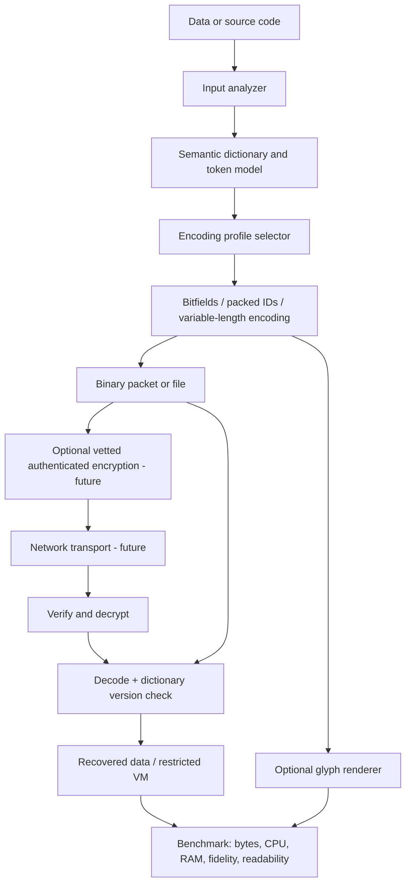

# Binbol · Complete project map (v0.4)

## What is the system?

A modular laboratory exploring the intersection of **binary encoding**, **semantic dictionaries**, **visual glyphs**, **tiny instruction sets**, **transport protocols**, **benchmarks**, and a **separate future security layer**.

**Current state:** a browser protocol simulation, binary packet files, 16-bit bitfields, symbolic editor, tiny educational VM and size tests. **Not yet built:** actual socket transport, encrypted E2E messaging, an optimizing compiler, real automatic profile selection and all numeric/image quantization paths.

## Keep interfaces separate

- `Dictionary`: stable schema, mapping/serialization, versioning and hash/identity.
- `Codec`: deterministic binary pack/unpack and explicit error handling.
- `Renderer`: display-only glyphs, independent of stored bytes.
- `Runtime`: executes a restricted, typed instruction set; no arbitrary shell execution.
- `Transport`: framing, authentication and endpoint verification; a separate module.
- `Profiler`: comparable workloads, complete byte counts, CPU/RAM and error reporting.

## Minimal experiment order

1. One shared dictionary + exact byte round-trip (exists).
2. Multi-token dictionary and strict versioned format.
3. Basic frequency-aware token assignment and varints / bitfields comparison.
4. Independent C implementation + benchmark on matching workloads.
5. Safe threat model + established protected transport.
6. Renderer/editor UX + automatic profile selection.

See [README](../README.md), [references](REFERENCES.md), [security](SECURITY_MODEL_HE.md), [Hebrew roadmap](ROADMAP_HE.md), [test sizes](../benchmarks/RESULTS_2026-11-18.md).